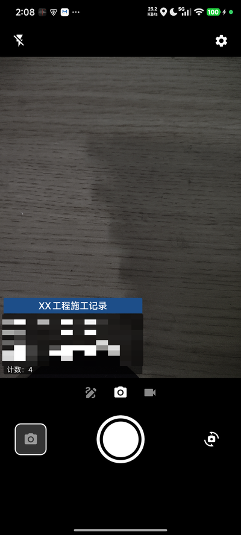
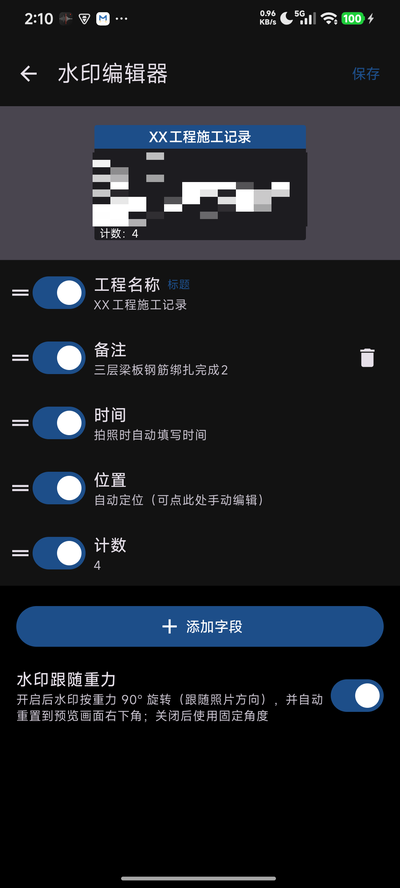
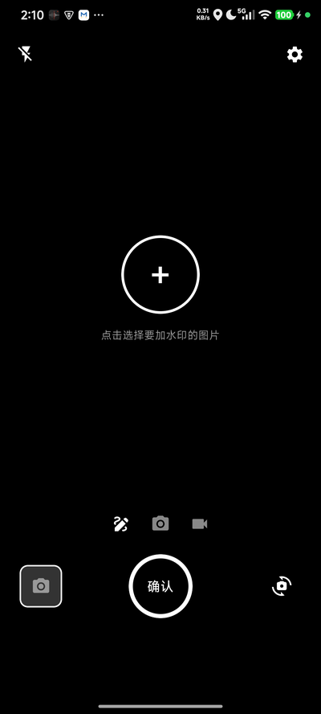

# engCamera · 水印相机 · engineering Camera

一个自用向的 Android 工程水印相机：拍照 / 录像前实时预览水印，成片直接把水印**烧录**进文件；也可以给相册里已有的图片批量补加水印。无广告、无登录、无云同步。

> 当前版本：v0.3.1-alpha（迭代中，修订记录见 [交付说明](交付说明.md)）

## 界面预览

| 相机（水印所见即所得） | 水印编辑器 | 给相册图片添加水印 |
|---|---|---|
|  |  |  |

*截图中的水印正文已做模糊处理。*

## 功能特性

### 拍摄

- **水印实时预览 + 烧录成片**：拍照前所见即所得，水印直接烧入 JPEG / MP4，不依赖元数据
- **录像比例与预览一致**：预览 / 拍照 / 录像统一裁剪到预览比例，成片不变形不裁切；支持画质档位（最高 / 超清 / 全高清 / 高清 / 标清）
- **点击对焦测光**：点预览任意位置下发对焦 + 测光 + 白平衡，4 秒自动回连续模式
- **重力方向跟随**：横拍（±90°）/ 倒置（180°）成片方向对齐系统相机，水印恒落左下、文字恒正立；水印可任意方向拖动
- **保存原图原视频**（设置项，默认关）：开启后拍照/录像同时保存无水印原片与水印成片

### 水印

- **可配置模板**：工程名称（标题）、时间、位置、计数、备注、自定义字段；可增删、拖动排序、启用/隐藏；连续底色样式（标题蓝条 + 正文半透明黑块，统一圆角），标题文字居中
- **自动定位 + 中文地址**：定位自动反查中文地址（如"广东省广州市天河区"），无网降级坐标显示；地址缓存防闪动；位置/时间支持手动编辑
- **计数字段**：拍照保存后自动 +1，适合施工/巡检打卡留痕
- **历史记录快填**：字段编辑时显示该标签最近填写的内容（最多 5 条），点击直接填入

### 相册与批处理

- **给已有图片加水印**：点笔图标进入，从系统相册多选图片，逐张拖动/编辑水印后确认，批量烧录保存
- **相册**：按拍摄时间从新到旧展示全部照片/视频，多选删除、捏合调列数、点击跳系统相册查看；从系统相册返回自动刷新列表

## 技术栈

| 项 | 选型 |
|---|---|
| 语言 / UI | Kotlin + Jetpack Compose（Material3） |
| 相机 | CameraX 1.6.2（常绑 Preview/ImageCapture/VideoCapture + ViewPort 统一比例） |
| 视频水印 | Media3 Transformer 1.11.1（录后转码烧入） |
| 定位 | FusedLocationProviderClient + Geocoder |
| 持久化 | DataStore Preferences + kotlinx.serialization |
| 相册 | MediaStore + Coil |

minSdk 24（Android 7.0+），targetSdk 36。

## 构建

```bash
./gradlew assembleDebug
# APK 输出：app/build/outputs/apk/debug/app-debug.apk
```

或在 Android Studio 中直接打开构建。

release 签名使用项目专属 keystore，配置放在 `app/keystore.properties`（不入库）：
克隆后如需构建签名版，参考 `app/build.gradle.kts` 中的读取逻辑自行配置。

## 保存位置

成片保存到 `DCIM/Camera/`，文件名前缀 `engCamera_`（如 `engCamera_20261011_153000.jpg`）。

## 已验证设备

- Redmi Note 12 Turbo（Android 15 / MIUI）：四方向拍照、录像水印与比例、7000+ 项相册、中文地址定位、点击对焦
- 模拟器 Pixel 10 Pro

## License

[MIT](LICENSE)
