<p align="center">
  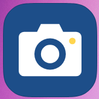
</p>

<h1 align="center">engCamera · 工程水印相机 · engineering Camera</h1>

<p align="center">
  <a href="https://github.com/zy8270/engCamera/releases/download/v0.6.19/engCamera-v0.6.19-281.apk">⬇️ 下载安卓版 Release</a>
  <br/>
  <a href="README_en.md">🇬🇧 English README</a>
</p>

一个自用向的 Android 工程水印相机：拍照 / 录像前实时预览水印，成片直接把水印**烧录**进文件；也可以给相册里已有的图片批量补加水印；多工地用**工程组**一键切换整套水印；连拍多张按红头模板**拼成一张**记录页。无广告、无登录、无云同步。

> 当前版本：v0.6.19（修订记录见 [交付说明](交付说明.md)）

## 界面预览

| 主界面（水印所见即所得） | 水印编辑器 | 拍照确认 · 手势标注 |
|---|---|---|
| 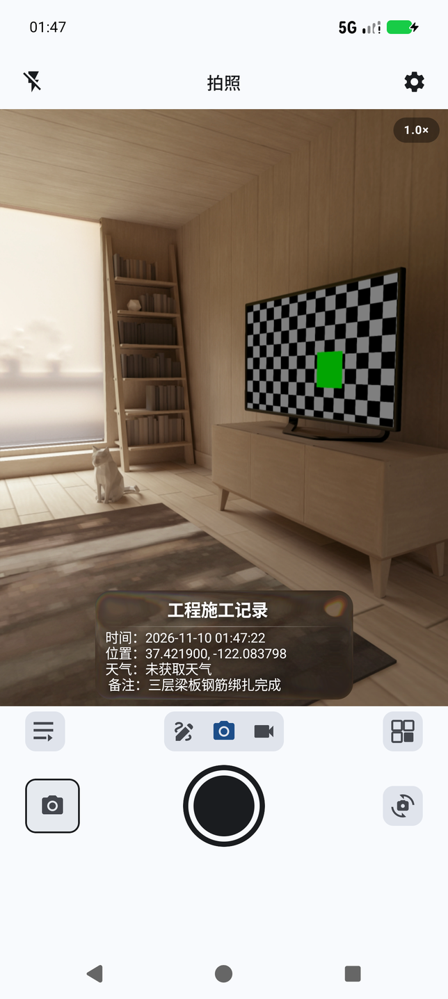 | 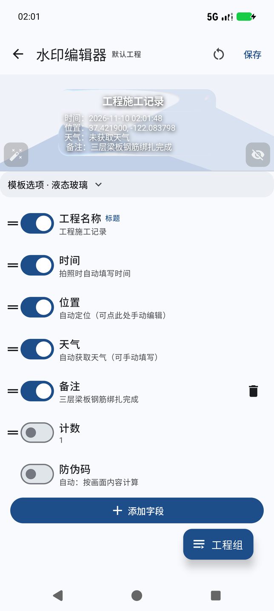 | 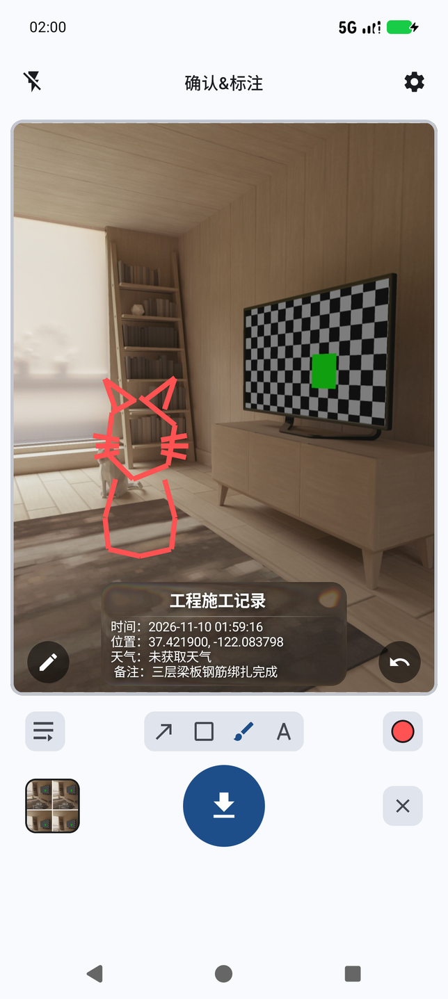 |

| 连拍拼图（小地图实时提示） | 连拍预览 · 拖动换位 | 拼图模板设置 |
|---|---|---|
| 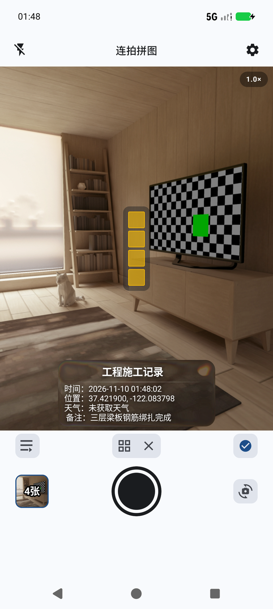 | 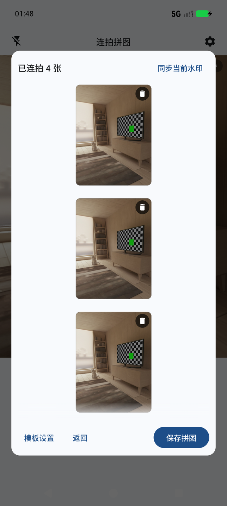 | 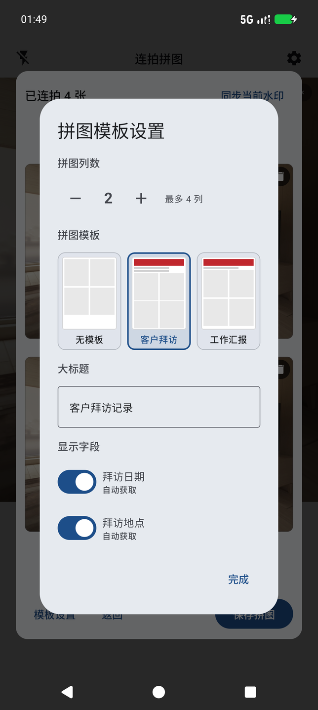 |

| 拼图成品（红头模板） | 给相册图片添加水印 | 设置抽屉 |
|---|---|---|
| 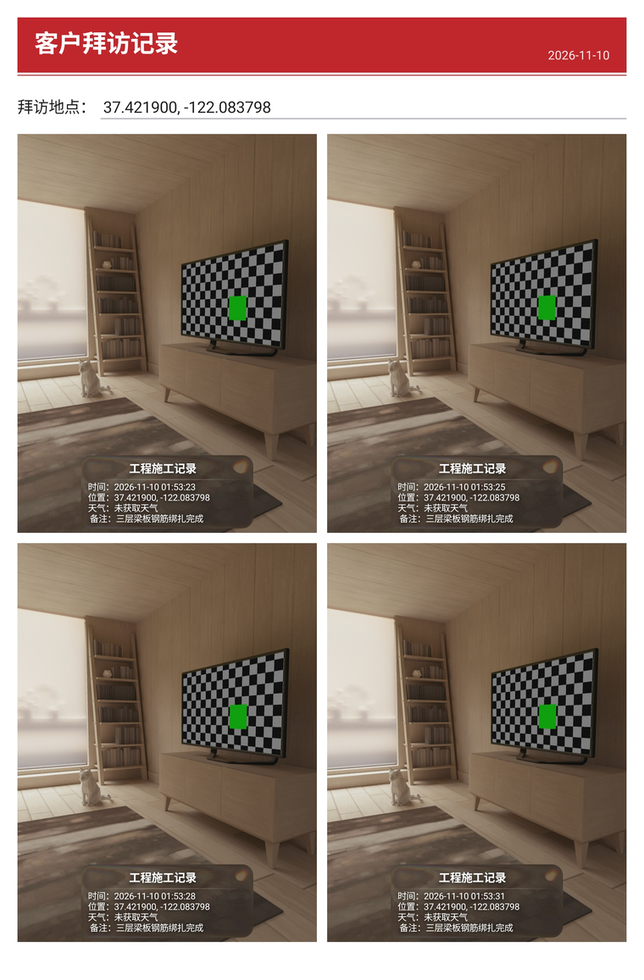 | 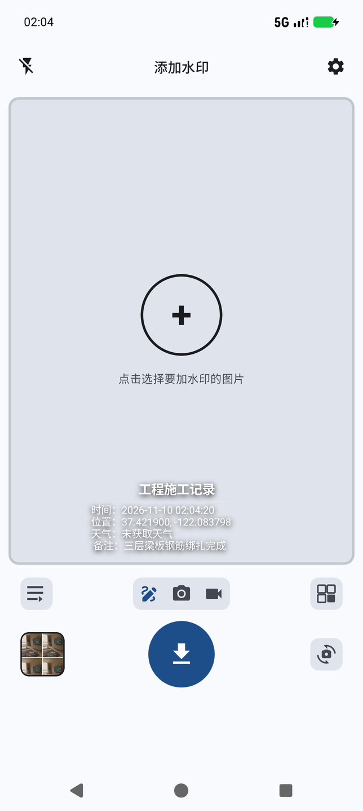 | 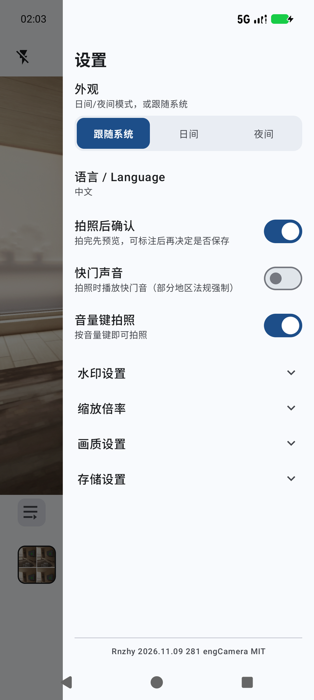 |

| 工程组 | 模板选择器 |
|---|---|
| 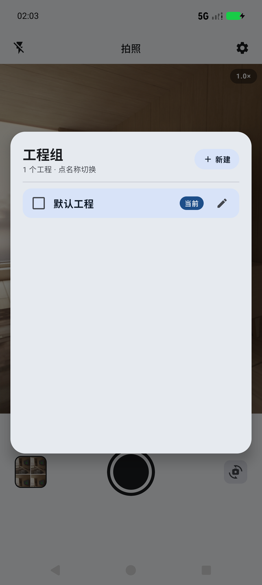 | 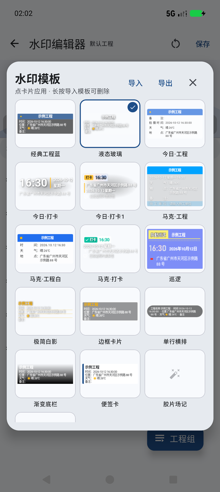 |

*截图取自模拟器（Android 17 / 1280×2856）。*

## 功能特性

### 拍摄

- **水印实时预览 + 烧录成片**：拍照前所见即所得，水印直接烧入 JPEG / MP4，不依赖元数据
- **拍照确认与手势标注**（设置项，默认开）：快门后先进确认页——箭头 / 矩形 / 笔刷标注（六色选择、逐笔撤销）、点按加文字（拖动移动、拉杆旋转缩放、即时改色）、**长按水印块拖动改位**（只影响本次保存，不动全局水印位置）；**双指缩放精细标注**：放大后松手保持缩放、单指继续落笔，笔画粗细定格在落笔时的倍率（放大时画的笔画永久更细，与成片一致），文字操作手柄尺寸恒定不随缩放变大；横拍 / 倒置照片在恒定 3:4 确认框内按真实比例居中、水印随重力回正到成片位置，双指放大可填满整框
- **中英双语界面**：跟随系统 / 中文 / English 三档（设置内切换），模板名、字段标签、提示文案全量随语言即时切换
- **录像比例与预览一致**：预览 / 拍照 / 录像统一裁剪到预览比例；画质档位按设备真实能力生成（显示实际成片分辨率与帧率，前摄自动无 4K）
- **照片 / 视频画质设置**：档位按当前镜头真实能力生成，菜单实标成片分辨率与像素量级（如 4624×3472 · 约16MP），选档即生效；入口在设置抽屉的「画质设置」组（v0.6.18 起从首页迁入）
- **电子变焦与多镜头**：双指捏合变焦，右上角倍数徽标点击 1×/2× 快切；多镜头机型在 1× 继续缩小自动切入更广镜头（如 0.6× 超广角），焦段胶囊单击轮询切换、长按展开全部焦段面板（单镜头机型自动隐藏，仅暴露连续变焦的机型由系统直接提供广角焦段）
- **点击对焦测光**：点预览任意位置对焦 + 测光 + 白平衡，4 秒自动回连续
- **重力方向跟随**：横拍（±90°）/ 倒置（180°）成片方向对齐系统相机，文字恒正立；水印位置九宫格点选或任意拖动，**参照系为重力**——选「下方」无论竖屏、横屏还是倒置，水印都稳定出现在物理重力下方
- **快门闪黑反馈**：拍照成功瞬间预览短暂闪黑一次，模拟机械快门，连拍不受影响
- **录像水印时间流动 + 旋转同步**：视频里水印的时间随录像实际时间走秒；录像中途旋转手机，成片水印的位置与角度和预览当时所见同步（时间流动限原生模板，网页模板定格在开录时刻）
- **UI 控件随重力旋转**：变焦徽标 / 焦段胶囊 / 录像角标 / 闪光灯等随持机方向旋转，横竖屏方向一致、不越界
- **保存原图原视频**（设置项，默认关）：开启后同时保存无水印原片；两个相册统一排序为水印版最新在前、原图第二张
- **成片文件名带工程名**：保存为 `engCamera_工程组名称_时间.jpg`（录像同规则 `.mp4`），多工程混拍也能按文件名区分归属；工程名中的非法字符自动清理、空白转下划线、最长 24 字，工程名为空时退回 `engCamera_时间`
- **保存路径自定义**（设置项）：默认 `DCIM/Camera`，可选 SAF 目录（自选文件夹）
- **快门声音 / 音量键拍照**（设置项）：快门音默认关（部分地市法规要求可开）；音量键视同快门默认开
- **每日检查更新**：启动时每天核对一次 GitHub Release 最新版本；有新版本时设置页底部更新提示带红点，点击直达下载页

### 连拍拼图

- **入口**：主页底栏右侧的拼图图标（原画质选择器位置，画质档位已迁入设置抽屉）。点击进入连拍拼图模式，顶部标题变为「连拍拼图」
- **连拍**：快门连续拍摄，照片先落缓存**不落相册**，每张各自烧录拍摄那一刻的水印（模板 / 样式 / 文字 / 时间地点全部冻结——中途改水印只影响之后的照片）
- **小地图**：取景框正中实时显示「列数 × 行数」的格子，已拍格标黄、未拍格透明；红头模板时上方带一条红色标识条
- **拼图模板**：内置 3 款——无模板（纯白缝网格）/ **客户拜访** / **工作汇报**（后两款为红头文件风格：红实底标题带、粗细双线、信息行、备注、右下落款）。模板与列数（1~4 列，默认 1）**带记忆**，下次进入沿用
- **字段可配**：红头模板的大标题与字段独立输入——拜访日期 / 汇报日期、拜访地点（自动取拍摄日期与定位）默认开，客户单位 / 拜访人 / 记录人签字 / 汇报单位 / 汇报人 / 备注默认关，逐项开关
- **连拍预览**：左下角按钮（背景=最后一张缩略图，「N张」白字黑描边压在缩略图中央）打开预览面板——按列数铺网格，每格右上角垃圾桶删除，**长按拖动换位**（拖动格放大浮起跟手，其它格弹簧让位；单列时纯上下躲闪），底部「模板设置 / 返回 / 保存拼图」，顶部「同步当前水印」可把当前水印一次性覆盖到所有已拍照片
- **保存**：全分辨率合成（每张保持原生尺寸、完全不缩放不裁剪；照片按列并排，行内白缝等宽），JPEG q98 只编码一次；超过内存预算时整体等比缩小并提示实际输出尺寸。合成期间显示**圆环进度 + 百分比 + 取消按钮**，取消后保留连拍缓存可重来
- **危险操作二次确认**：退出拼图模式、生成拼图、同步水印、删除单张均有确认框

### 水印

- **液态玻璃默认模板**：内置 [AndroidLiquidGlassView](https://github.com/QmDeve/AndroidLiquidGlassView)（MIT）实时渲染的 iOS 液态玻璃卡——边缘折射 + 色散实时采样相机画面，预览所见即所得，拍照烧录同款着色器保证成片一致；**录像成片同样带真实折射**（自定义 GPU 帧效果逐帧采样视频画面）；**给相册图片加水印与确认页照片也是真实折射**（静态图全分辨率渲染，拖到哪里扭到哪里）；圆角（占短边百分比，50% 拉满正半圆）/ 折射高度 / 折射偏移 / 着色 / 色散 / 模糊等背景参数可调，标题 / 正文文字颜色、阴影（大小/扩散/透明度/垂直偏移）、水印宽度、记录点独立可调；竖屏 / 横屏 / 倒置四方向全走 GPU 实时路径，预览帧率一致（液态玻璃效果需 Android 13+，低版本自动退化为半透明玻璃底）
- **水印模板系统**：内置 16 款——原生 14 款（经典工程蓝 / 液态玻璃 / 今日·工程 / 今日·打卡 / 今日·打卡1 / 马克·工程 / 马克·工程白 / 马克·打卡 / **巡逻** / 极简白影 / 边框卡片 / 单行横排 / 渐变底栏 / 便签卡，Canvas 直绘零开销）+ 网页 2 款（胶片场记 / 杂志卡片，HTML/CSS 离线渲染）；每款模板暴露自己的可调项（标题/正文/背景颜色、边框粗细、圆角、渐变基色、水印宽度、网页整体缩放等），随工程保存；网页模板支持 HTML 导入导出，模板也可整份导出（含字段值/样式/位置）到剪贴板或文件，另一台设备导入即还原
- **打卡/工程记录系列模板**：今日·打卡 / 今日·打卡1 / 马克·打卡 大字时间 + 日期/星期/天气 + 地址备注，仿主流打卡相机样式；马克·系列带标题栏与标签两端对齐字段卡；背景放射阴影（宽/高/深浅/扩散/颜色）拉杆可调，今日·系列备注支持多条展示与白→透明渐变底，马克·工程"施工单位"为独立字段（空白显示占位）且永远置底；**巡逻**：半透明蓝卡 + 黄块固定「执勤巡逻」（膨胀描边硬阴影）+ 可编辑标题「工作记录」+ 尖角箭头带 + Bahnschrift 字体大号时间（内嵌白蓝→白红→白蓝渐变钱币纹）+ 红方块地址行，卡片/标题块/文字颜色与水印宽度可调
- **水印位置与透明度**：所有模板可视化点选 9 宫格位置（四角 / 四边 / 正中），不随转向重置，也可直接拖动微调；上下左右按**物理重力方向**解释——横拍时「下方」就是桌面所在侧；同栏内**整体透明度**拉杆（10%~100%，预览与成片一致，防伪码不受影响）
- **编辑器实时相机预览（眼睛开关）**：编辑器预览区点"眼睛"把背景换成相机实时画面，液态玻璃实时折射所见即所得，调参更直观；默认闭眼为取景器截帧背景（进入编辑器瞬间的画面，设置内"取景器截帧背景"可关，关闭后为深/亮两套扁平山形图案背景）
- **工程组**：多套水印配置一键切换（新建=复制当前、重命名、批量删除、一键重置），编辑器标题实时显示当前工程；**相机底栏模式切换左侧常驻快捷入口**——多工地不用进编辑器直接换水印；新建工程时输入的工程名可自动填入该工程水印标题（设置内可关）
- **可配置字段**：工程名称（标题）、时间、位置、天气、备注、计数、自定义字段；可增删、拖动排序、启用隐藏；时间/位置/天气支持手动定格（标"自定义"标签）并可一键重置回自动；位置文本可开关尾部经纬度显示（默认关）；字段编辑支持「确定并保存」——保存后直接回拍照页继续拍下一张
- **自动定位 + 中文地址**：多机型兼容（系统 Geocoder 整行 → 结构化字段拼接 省/市/区/路/地点 → 在线反查三级兜底），无网降级坐标；地址/天气持久化缓存，重启不清空
- **自动天气 + Emoji**：随定位获取（如"☀️ 晴 26℃"），天气词自动配扁平 emoji（晴/多云/阴/雨/雪/雷/雾…），可在天气字段编辑内开关；支持手动填写与刷新
- **计数字段**：拍照保存后自动 +1（默认关，可开启）
- **防伪码**（默认关）：成片右下角常驻一行 14 位大写字母+数字的**内容指纹**（加盐 `EngCameraRnzhy`，由画面内容算出，非随机数），配合根目录 `verify_anticounterfeit.py` 脚本可校验照片是否被改过并给出偏差百分比。**忽略水印、无视批注**——指纹算在未加水印未批注的原始画面上，所以只有无批注那张可校验。能抗 JPEG 重压缩 / 平台降噪 / 缩放 / 整体调色（实测 ≤5% 偏差），但属内容指纹而非密码学签名，小面积局部改动（约 2% 画面）检测不出来，详见 [交付说明](交付说明.md)。编辑器可手动改码；预览显示占位符并跟随重力贴物理右下角
- **品牌 logo**（4 款工程模板）：经典工程蓝 / 马克·工程 / 马克·工程白 / 今日·工程的标题栏左侧可放 logo 容器——默认 app 图标，可从相册选图（任意比例按原比例缩小入容器、支持透明 PNG、容器白底），「logo 大小」拉杆调节容器边长（最大钳到水印宽 50%），标题行随之顶高、文字在剩余右半边居中并先换行再省略，圆角模板的容器自动被裁圆；选了 logo 会自动关闭记录点
- **编辑即开开关**：主动编辑任意字段内容（确定 / 确定并保存）会自动打开该字段开关；点重置不打开

### 相册与批处理

- **给已有图片加水印**：笔图标进入（空态 + 号或下载键发起选图），系统选择器多选（最多 30 张），逐张进入与拍照确认同一套标注界面——箭头 / 矩形 / 笔刷 / 文字工具、六色 + 自由选色、逐笔撤销、双指缩放，标注盖水印烧录、多张按 x/y 进度依次保存；长按水印块拖动改位，水印方向锁定与图片同正
- **相册**：拍摄时间从新到旧，默认 4 列、捏合 3~6 列，多选删除、点击跳系统相册；返回自动刷新

## 技术栈

| 项 | 选型 |
|---|---|
| 语言 / UI | Kotlin + Jetpack Compose（Material3，跟随系统 / 日间 / 夜间三档主题） |
| 相机 | CameraX 1.6.2（四用例常绑 + ViewPort 统一比例 + TextureView 预览） |
| 视频水印 | Media3 Transformer 1.11.1（录后转码烧入） |
| 网页水印模板 | WebView 离屏渲染（WebView 池并行 + LRU 缓存 + 磁盘缩略图） |
| 液态玻璃 | [AndroidLiquidGlassView](https://github.com/QmDeve/AndroidLiquidGlassView)（AGSL 实时折射，MIT）+ 同款着色器 CPU 烧录移植 |
| 定位/天气 | FusedLocationProvider + Geocoder + Open-Meteo |
| 持久化 | DataStore Preferences + kotlinx.serialization |
| 相册 | MediaStore + Coil |

minSdk 24（Android 7.0+），targetSdk 36。

## 构建

```bash
./gradlew assembleDebug
# APK 输出：app/build/outputs/apk/debug/app-debug.apk
```

或在 Android Studio 中直接打开构建。release 签名使用项目专属 keystore，配置放在 `app/keystore.properties`（不入库）。

## 保存位置

默认保存到 `DCIM/Camera/`，文件名前缀 `engCamera_` 并嵌入当前工程组名（如 `engCamera_一号工地_20261021_102019.jpg`；工程名为空时为 `engCamera_20261021_102019.jpg`；双保存时水印版为主名、原图带 (1)）；可在设置中选择其他文件夹（SAF）。

## 已验证设备

- Redmi Note 12 Turbo（Android 15 / MIUI）：四方向拍照、录像比例与水印、点击对焦、批量加水印、工程组、天气、7000+ 项相册
- iQOO Neo 10 Pro（无完整 GMS）：中文地址多级兜底拼接
- Android 模拟器（带 GMS）：定位/天气/网页水印模板全链路

## License

[MIT](LICENSE)
