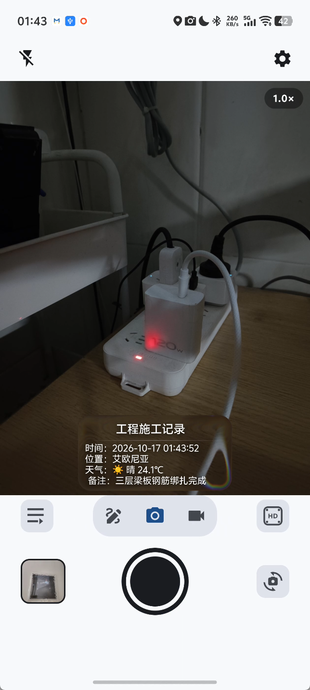
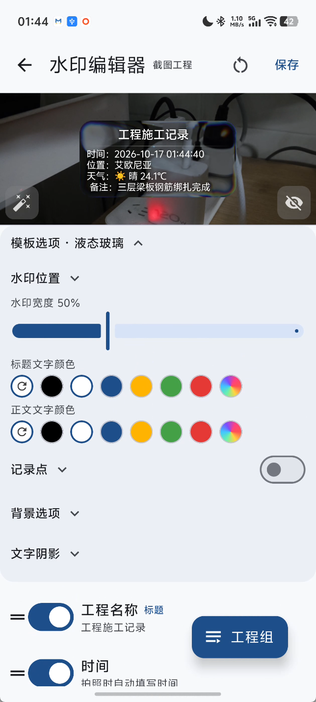
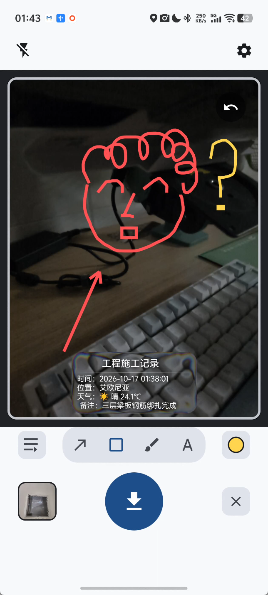
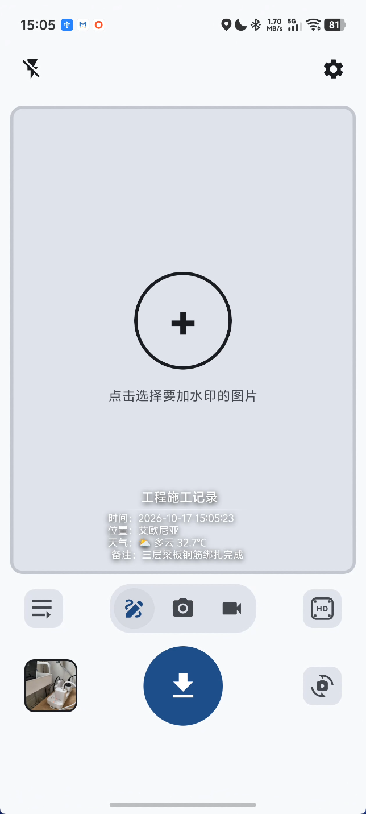
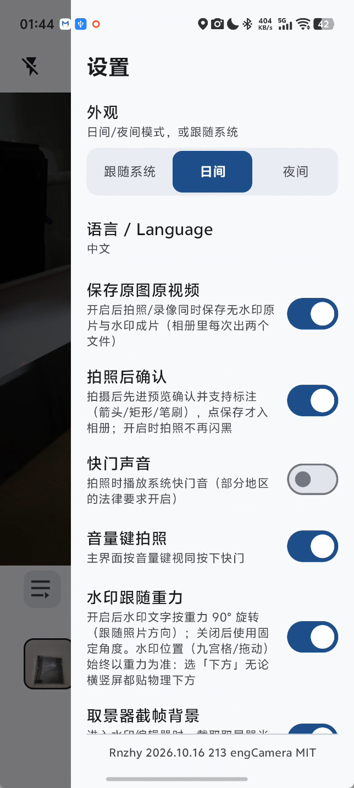
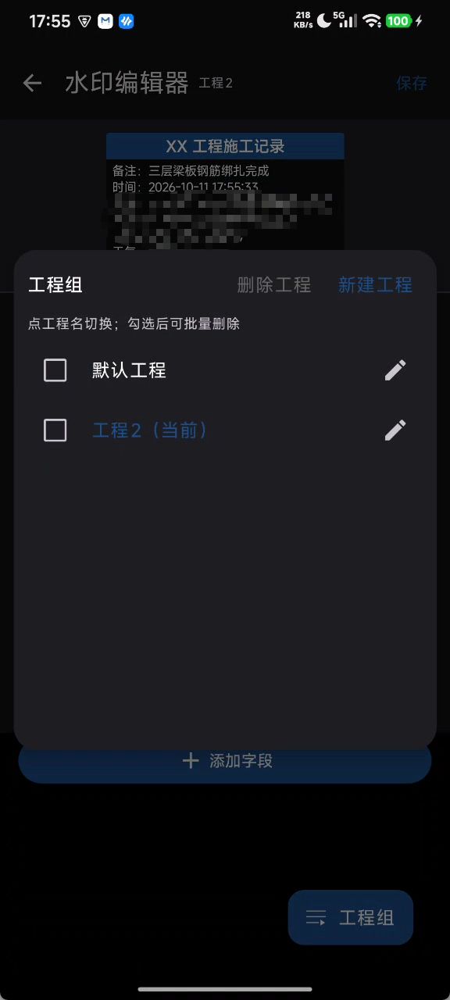

<p align="center">
  
</p>

<h1 align="center">engCamera · Engineering Watermark Camera</h1>

<p align="center">
  <a href="https://github.com/zy8270/engCamera/releases/download/v0.6.7/engCamera-v0.6.7.apk">⬇️ Download Android Release</a>
  <br/>
  <a href="README.md">🇨🇳 中文说明</a>
</p>

A personal-use Android camera for engineering work: watermarks are previewed live before you shoot and **burned into** the final JPEG / MP4. It can also batch-watermark existing photos from your gallery, and multiple **project profiles** switch the whole watermark set in one tap. No ads, no sign-in, no cloud sync.

> Current version: v0.6.7 (revision history in [交付说明](交付说明.md), Chinese)

## Screenshots

| Main screen (live WYSIWYG watermark) | Watermark editor | Confirm · annotate |
|---|---|---|
|  |  |  |

| Watermark gallery photos | Settings drawer | Project groups |
|---|---|---|
|  |  |  |

*Screenshots taken on real devices.*

## Features

### Capture

- **Live watermark preview + burned output**: what you see before pressing the shutter is what gets burned into the file — no metadata tricks
- **Shot confirm & gesture annotation** (setting, on by default): after the shutter you get a confirm page — arrow / rectangle / brush annotations (six colors, undo per stroke), tap-to-add text (drag to move, handle to rotate & scale, instant recolor); **pinch to zoom for fine annotation**: zoom stays after lifting your fingers, single finger keeps drawing, stroke width is locked to the zoom level at pen-down (strokes drawn zoomed-in stay thinner, matching the saved photo), and text handles keep a constant size; landscape / upside-down shots are centered at true aspect inside a fixed 3:4 confirm frame with the watermark gravity-corrected to its final position, and can be zoomed to fill the frame
- **Bilingual UI (Chinese / English)**: follow system / Chinese / English, switchable in settings — template names, field labels and prompts all switch instantly
- **Video aspect matches the preview**: preview / photo / video are cropped to the same ratio; quality tiers are generated from the camera's real capabilities (showing actual output resolution & frame rate; no 4K on front cameras)
- **Photo quality picker**: tiers follow the current lens' true capabilities, labeled with real output resolution and megapixels (e.g. 4624×3472 · ~16MP)
- **Electronic zoom & multi-lens**: pinch to zoom, tap the badge for 1×/2× quick toggle; on multi-lens devices, pinching below 1× auto-switches to a wider lens (e.g. 0.6× ultra-wide); focal capsule cycles on tap, long-press expands the full focal panel (hidden on single-lens devices)
- **Tap to focus & meter**: tap anywhere to focus + meter + white balance, auto-return to continuous after 4 s
- **Gravity-following orientation**: landscape (±90°) / upside-down (180°) output orientation aligns with the system camera, text always upright; the watermark 9-grid position follows **gravity** — pick "bottom" and it stays on the physical bottom in any orientation
- **Shutter blackout feedback**: the preview flashes black for an instant on success, like a mechanical shutter; burst-friendly
- **Video watermark: ticking time + rotation sync**: in videos the watermark clock ticks with the recording; rotating mid-recording keeps position and angle in sync with what the preview showed (ticking time applies to native templates; web templates freeze at record start)
- **Gravity-rotating UI chrome**: zoom badge / focal capsule / REC badge / flash icon rotate with device orientation without overflowing
- **Save originals** (setting, off by default): keep an un-watermarked copy alongside; both galleries order watermarked-newest first, original second
- **Custom save location** (setting): default `DCIM/Camera`, or any SAF folder you pick
- **Shutter sound / volume-key shutter** (settings): shutter sound off by default (enable where local law requires); volume keys act as shutter, on by default

### Watermark

- **Liquid Glass default template**: an iOS-style liquid glass card rendered live by the bundled [AndroidLiquidGlassView](https://github.com/QmDeve/AndroidLiquidGlassView) (MIT) — edge refraction + dispersion sampled from the live camera feed, WYSIWYG in preview and burned with the same shader; **videos get true refraction too** (a custom GPU frame effect samples the video itself frame by frame); corner radius / refraction height & offset / tint / dispersion / blur are adjustable, as are text colors, shadow (size / spread / opacity / offset), watermark width and record point; all four orientations run the GPU path at full frame rate (requires Android 13+; older versions fall back to a translucent glass base)
- **Template system**: 9 built-in — 7 native (classic engineering blue / liquid glass / minimal white shadow / bordered card / single-line / gradient bar / note card, drawn directly on Canvas at zero cost) + 2 web (film slate / magazine card, offline HTML/CSS); each template exposes its own knobs (title/body/background colors, border, radius, gradient base, width, web scale…), saved per project; web templates export/import as HTML, and any template exports whole (fields/styles/position) to clipboard or file for another device
- **9-grid position**: visually pick any of 9 slots (corners / edges / center), never reset by rotation, or fine-tune by dragging; directions are interpreted in the **physical gravity** frame — in landscape, "bottom" is the table side
- **Editor live camera preview (eye toggle)**: tap the "eye" in the editor to swap the background for the live rear camera — liquid glass refracts it live; closed eye = viewfinder freeze-frame background (settings toggle; off = flat dual-mountain artwork, dark/light variants)
- **Project groups**: one-tap switch between complete watermark configs (create = copy current, rename, bulk delete, reset), current project shown in the editor title; a persistent quick entry sits left of the bottom mode switch so multi-site users never open the editor just to swap; a new group's name can auto-fill its watermark title (setting)
- **Configurable fields**: project name (title), time, location, weather, counter, note, custom fields; add/remove/reorder/enable per field; time/location/weather support manual freeze (marked "custom") with one-tap reset; location text can append lat/lng (off by default)
- **Auto location + Chinese addresses**: multi-device fallback chain (system Geocoder → structured province/city/district/road/place join → online reverse-geocode), degrades to coordinates offline; address/weather cached across restarts
- **Auto weather + emoji**: fetched with location (e.g. "☀️ 晴 26℃"), flat emoji per condition (sunny/cloudy/overcast/rain/snow/storm/fog…), toggleable, manual entry & refresh supported
- **Counter field**: auto +1 per saved photo (off by default, enable in settings)

### Gallery & batch

- **Watermark existing photos**: pencil icon → system multi-picker (up to 30) → per-photo edit & confirm → batch save
- **Gallery**: newest first, 4 columns by default (pinch 3–6), multi-select delete, tap opens the system viewer; auto-refresh on return

## Tech stack

| Item | Choice |
|---|---|
| Language / UI | Kotlin + Jetpack Compose (Material3; system / light / dark themes) |
| Camera | CameraX 1.6.2 (all four use cases bound + ViewPort ratio + TextureView preview) |
| Video watermark | Media3 Transformer 1.11.1 (post-record transcode burn-in) |
| Web templates | Off-screen WebView (pool + LRU cache + disk thumbnails) |
| Liquid glass | [AndroidLiquidGlassView](https://github.com/QmDeve/AndroidLiquidGlassView) (AGSL live refraction, MIT) + same-shader CPU burn-in port |
| Location / weather | FusedLocationProvider + Geocoder + Open-Meteo |
| Persistence | DataStore Preferences + kotlinx.serialization |
| Gallery | MediaStore + Coil |

minSdk 24 (Android 7.0+), targetSdk 36.

## Build

```bash
./gradlew assembleDebug
# APK output: app/build/outputs/apk/debug/app-debug.apk
```

Or open the project in Android Studio. Release signing uses a project-local keystore configured in `app/keystore.properties` (not committed).

## Save location

Defaults to `DCIM/Camera/` with the `engCamera_` prefix (e.g. `engCamera_20261011_153000.jpg`; with "save originals" the watermarked copy keeps the base name and the original gets "(1)"); a custom folder (SAF) can be chosen in settings.

## Verified devices

- Redmi Note 12 Turbo (Android 15 / MIUI): four-orientation capture, video ratio & watermark, tap-to-focus, batch watermarking, project groups, weather, 7000+ item gallery
- iQOO Neo 10 Pro (no full GMS): multi-level Chinese address fallback
- Android emulator (with GMS): full location / weather / web-template pipeline

## License

[MIT](LICENSE)
