<p align="center">
  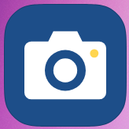
</p>

<h1 align="center">engCamera · Engineering Watermark Camera</h1>

<p align="center">
  <a href="https://github.com/zy8270/engCamera/releases/download/v0.6.19/engCamera-v0.6.19-281.apk">⬇️ Download Android Release</a>
  <br/>
  <a href="README.md">🇨🇳 中文说明</a>
</p>

A personal-use Android camera for engineering work: watermarks are previewed live before you shoot and **burned into** the final JPEG / MP4. It can also batch-watermark existing photos from your gallery, multiple **project profiles** switch the whole watermark set in one tap, and bursts of shots can be **stitched into a single red-header record sheet**. No ads, no sign-in, no cloud sync.

> Current version: v0.6.19 (revision history in [交付说明](交付说明.md), Chinese)

## Screenshots

| Main screen (live WYSIWYG watermark) | Watermark editor | Confirm · annotate |
|---|---|---|
| 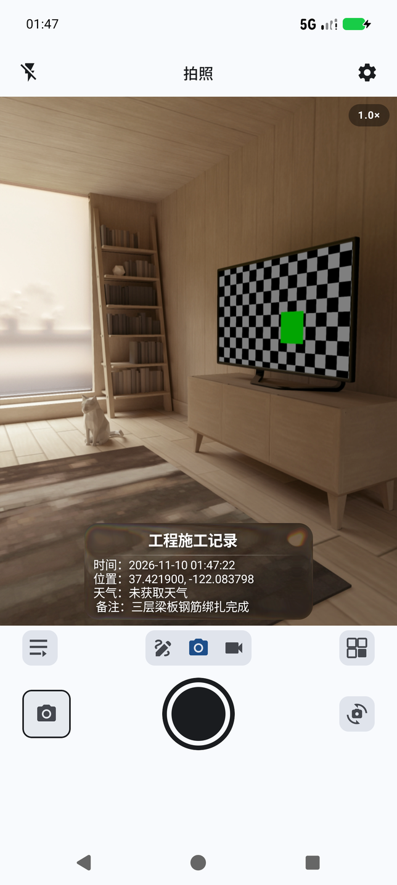 | 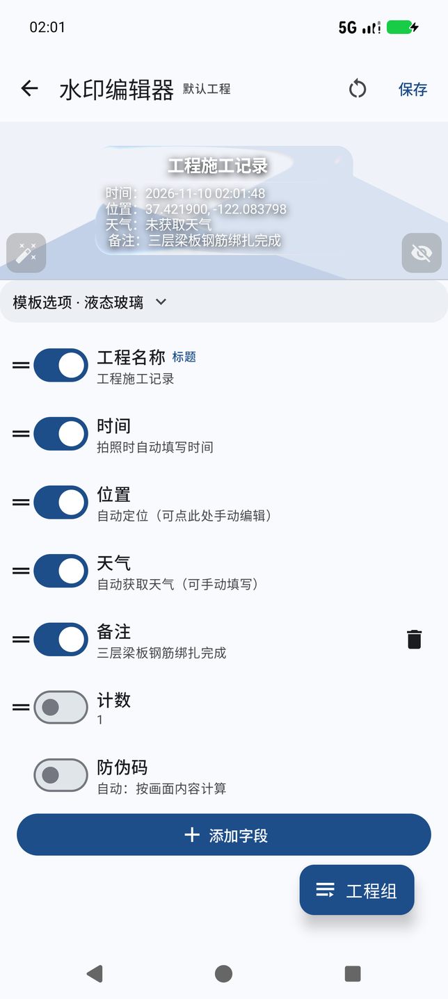 | 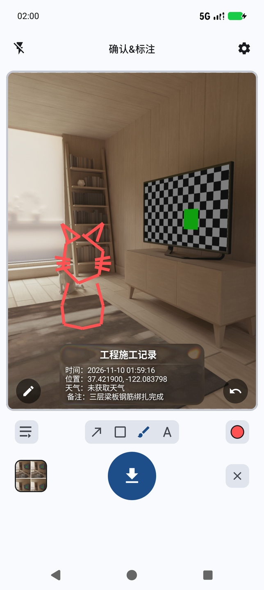 |

| Burst collage (live minimap) | Burst review · drag to reorder | Collage template settings |
|---|---|---|
| 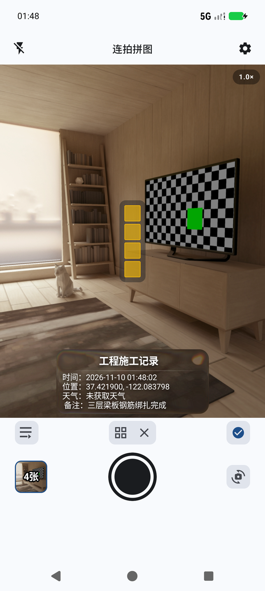 | 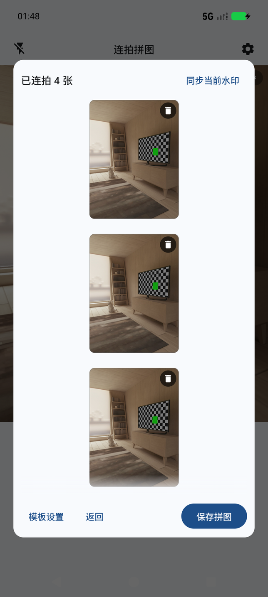 | 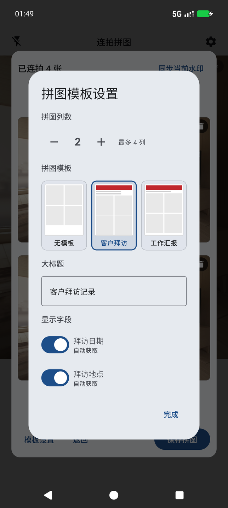 |

| Collage output (red-header template) | Watermark gallery photos | Settings drawer |
|---|---|---|
| 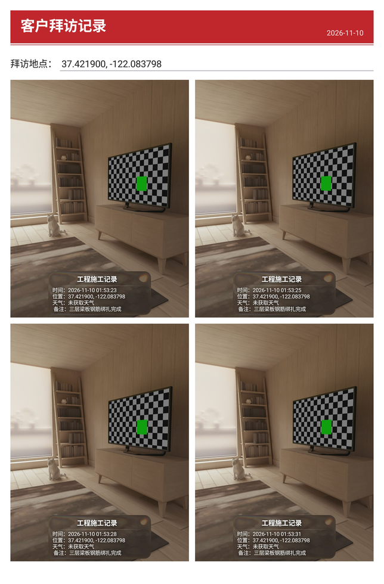 | 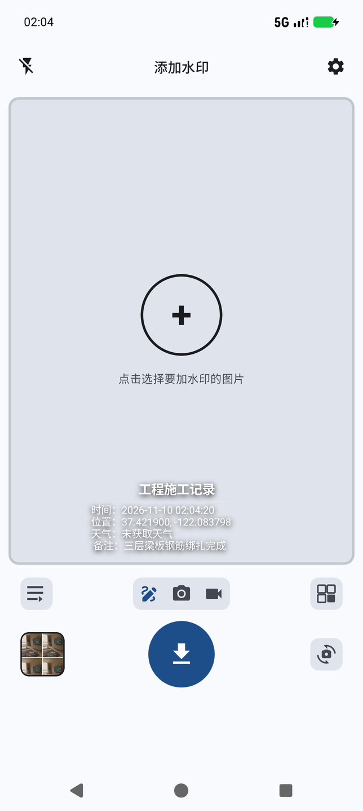 | 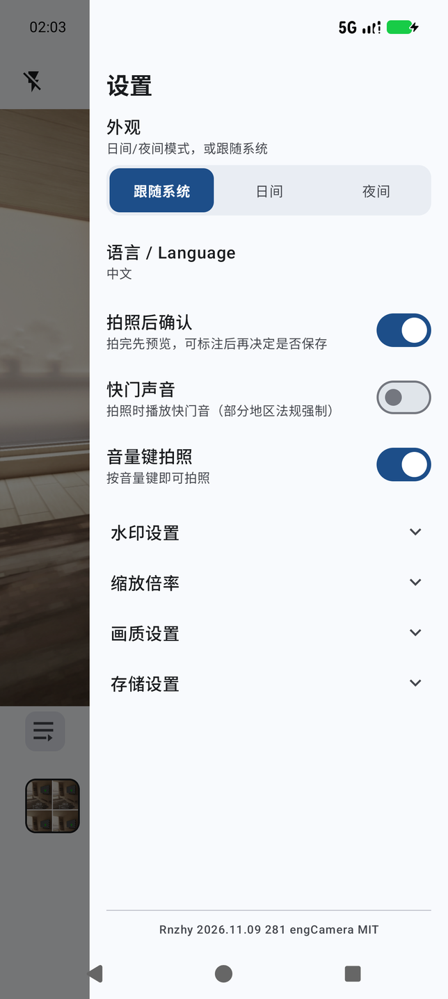 |

| Project groups | Template picker |
|---|---|
| 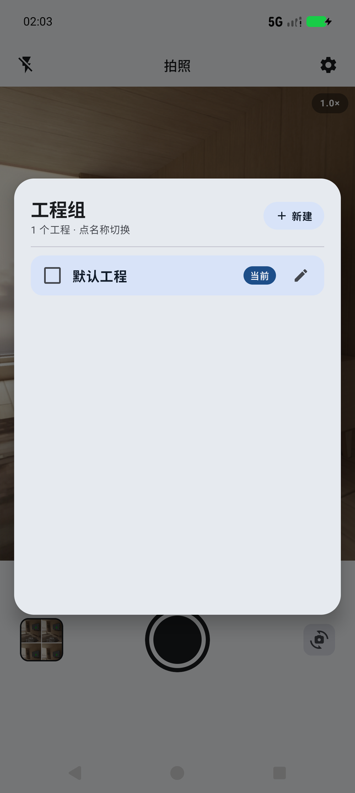 | 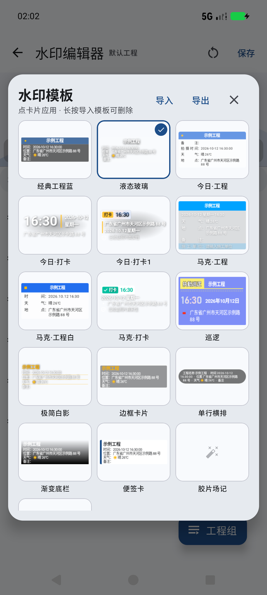 |

*Screenshots taken on the emulator (Android 17 / 1280×2856).*

## Features

### Capture

- **Live watermark preview + burned output**: what you see before pressing the shutter is what gets burned into the file — no metadata tricks
- **Shot confirm & gesture annotation** (setting, on by default): after the shutter you get a confirm page — arrow / rectangle / brush annotations (six colors, undo per stroke), tap-to-add text (drag to move, handle to rotate & scale, instant recolor), and **long-press the watermark block to drag it** (affects only this save, not the global position); **pinch to zoom for fine annotation**: zoom stays after lifting your fingers, single finger keeps drawing, stroke width is locked to the zoom level at pen-down (strokes drawn zoomed-in stay thinner, matching the saved photo), and text handles keep a constant size; landscape / upside-down shots are centered at true aspect inside a fixed 3:4 confirm frame with the watermark gravity-corrected to its final position, and can be zoomed to fill the frame
- **Bilingual UI (Chinese / English)**: follow system / Chinese / English, switchable in settings — template names, field labels and prompts all switch instantly
- **Video aspect matches the preview**: preview / photo / video are cropped to the same ratio; quality tiers are generated from the camera's real capabilities (showing actual output resolution & frame rate; no 4K on front cameras)
- **Photo / video quality settings**: tiers follow the current lens' true capabilities, labeled with real output resolution and megapixels (e.g. 4624×3472 · ~16MP); moved into the "Quality" group of the settings drawer as of v0.6.18
- **Electronic zoom & multi-lens**: pinch to zoom, tap the badge for 1×/2× quick toggle; on multi-lens devices, pinching below 1× auto-switches to a wider lens (e.g. 0.6× ultra-wide); focal capsule cycles on tap, long-press expands the full focal panel (hidden on single-lens devices)
- **Tap to focus & meter**: tap anywhere to focus + meter + white balance, auto-return to continuous after 4 s
- **Gravity-following orientation**: landscape (±90°) / upside-down (180°) output orientation aligns with the system camera, text always upright; the watermark 9-grid position follows **gravity** — pick "bottom" and it stays on the physical bottom in any orientation
- **Shutter blackout feedback**: the preview flashes black for an instant on success, like a mechanical shutter; burst-friendly
- **Video watermark: ticking time + rotation sync**: in videos the watermark clock ticks with the recording; rotating mid-recording keeps position and angle in sync with what the preview showed (ticking time applies to native templates; web templates freeze at record start)
- **Gravity-rotating UI chrome**: zoom badge / focal capsule / REC badge / flash icon rotate with device orientation without overflowing
- **Save originals** (setting, off by default): keep an un-watermarked copy alongside; both galleries order watermarked-newest first, original second
- **Project name in the file name**: saved as `engCamera_<project>_<time>.jpg` (videos: `.mp4`), so shots from different projects stay distinguishable; illegal characters are stripped, whitespace becomes `_`, capped at 24 chars, and an empty project name falls back to `engCamera_<time>`
- **Custom save location** (setting): default `DCIM/Camera`, or any SAF folder you pick
- **Shutter sound / volume-key shutter** (settings): shutter sound off by default (enable where local law requires); volume keys act as shutter, on by default
- **Daily update check**: every launch compares the app version with the latest GitHub Release once a day; when a newer version exists the settings footer shows an update notice with a red dot that links straight to the download page

### Burst collage

- **Entry**: the collage icon at the right of the bottom bar (where the quality picker used to be — quality moved into the settings drawer). Tapping it enters burst-collage mode and the top title switches to "Burst collage"
- **Burst capture**: shots go to a cache first, **not** to the gallery, and each one burns the watermark frozen at its own shutter moment (template / style / text / time & location all frozen — editing the watermark mid-burst only affects later shots)
- **Minimap**: a live grid of "columns × rows" in the middle of the viewfinder; captured cells turn yellow, pending cells stay transparent, and red-header templates get a red strip on top
- **Templates**: three built in — No template (plain white-gap grid) / **Client visit** / **Work report** (the latter two are red-header document styles: solid red title band, thick+thin rules, info rows, notes, signature line). Template and column count (1–4, default 1) are **remembered** for next time
- **Configurable fields**: the red-header templates have their own title and field inputs — visit/report date and location (auto-filled from shot time and GPS) on by default; client, visitor, signature, department, reporter and notes off by default, each toggleable
- **Burst review**: the bottom-left button (thumbnail background with an outlined "N photos" label centered on top) opens the review panel — a grid matching the column count, a trash icon per cell, **long-press drag to reorder** (the dragged cell lifts and follows your finger while the others spring out of the way; single column dodges vertically), and Template / Back / Save buttons at the bottom. "Apply current watermark" at the top overwrites every captured photo's frozen watermark at once
- **Saving**: full-resolution composite — every photo keeps its **native size with no scaling and no cropping**; photos sit side by side with equal white gaps. JPEG q98, encoded exactly once. If the total exceeds the memory budget the whole page is scaled down proportionally and the actual output size is reported. A **ring progress + percentage + cancel button** is shown while compositing; cancelling keeps the burst cache so you can retry
- **Confirmation on destructive actions**: exiting collage mode, generating, applying the watermark and deleting a shot all ask first

### Watermark

- **Liquid Glass default template**: an iOS-style liquid glass card rendered live by the bundled [AndroidLiquidGlassView](https://github.com/QmDeve/AndroidLiquidGlassView) (MIT) — edge refraction + dispersion sampled from the live camera feed, WYSIWYG in preview and burned with the same shader; **videos get true refraction too** (a custom GPU frame effect samples the video itself frame by frame); **gallery-photo watermarking and the confirm page get true refraction as well** (full-resolution static rendering — it refracts wherever you drag it); corner radius (percent of the short side, 50% = full semicircle) / refraction height & offset / tint / dispersion / blur are adjustable, as are text colors, shadow (size / spread / opacity / offset), watermark width and record point; all four orientations run the GPU path at full frame rate (requires Android 13+; older versions fall back to a translucent glass base)
- **Template system**: 16 built-in — 14 native (classic engineering blue / liquid glass / Today Site / Today Clock-in / Today Clock-in 1 / Mark Site / Mark Site White / Mark Clock-in / **Patrol** / minimal white shadow / bordered card / single-line / gradient bar / note card, drawn directly on Canvas at zero cost) + 2 web (film slate / magazine card, offline HTML/CSS); each template exposes its own knobs (title/body/background colors, border, radius, gradient base, width, web scale…), saved per project; web templates export/import as HTML, and any template exports whole (fields/styles/position) to clipboard or file for another device
- **Clock-in / site-record template series**: Today Clock-in / Today Clock-in 1 / Mark Clock-in show a big time with date / weekday / weather and address notes, styled after mainstream clock-in cameras; Mark series adds a title bar with justified label columns; the radial backdrop shadow (width / height / strength / spread / color) has dedicated sliders, the Today series supports multiple note lines on a white-to-transparent fade, and Mark Site keeps a dedicated "contractor" field (placeholder when empty) pinned to the bottom; **Patrol**: translucent blue card + yellow block with fixed "执勤巡逻" in a hard dilation-outline shadow + editable "工作记录" title + sharp chevron band + big Bahnschrift time with an embedded white-blue → white-red → white-blue gradient guilloche texture + red-square address line; card / title-block / text colors and width are adjustable
- **Position & opacity**: visually pick any of 9 slots (corners / edges / center), never reset by rotation, or fine-tune by dragging; directions are interpreted in the **physical gravity** frame — in landscape, "bottom" is the table side; the same fold holds an **overall opacity** slider (10%~100%, preview matches the burned output; the anti-counterfeit code is unaffected)
- **Editor live camera preview (eye toggle)**: tap the "eye" in the editor to swap the background for the live rear camera — liquid glass refracts it live; closed eye = viewfinder freeze-frame background (settings toggle; off = flat dual-mountain artwork, dark/light variants)
- **Project groups**: one-tap switch between complete watermark configs (create = copy current, rename, bulk delete, reset), current project shown in the editor title; a persistent quick entry sits left of the bottom mode switch so multi-site users never open the editor just to swap; a new group's name can auto-fill its watermark title (setting)
- **Configurable fields**: project name (title), time, location, weather, note, counter, custom fields; add/remove/reorder/enable per field; time/location/weather support manual freeze (marked "custom") with one-tap reset; location text can append lat/lng (off by default); field editing offers "OK & Save" — saves and returns straight to the camera to shoot the next shot
- **Auto location + Chinese addresses**: multi-device fallback chain (system Geocoder → structured province/city/district/road/place join → online reverse-geocode), degrades to coordinates offline; address/weather cached across restarts
- **Auto weather + emoji**: fetched with location (e.g. "☀️ 晴 26℃"), flat emoji per condition (sunny/cloudy/overcast/rain/snow/storm/fog…), toggleable, manual entry & refresh supported
- **Counter field**: auto +1 per saved photo (off by default, enable in settings)
- **Anti-forgery code** (off by default): a 14-character alphanumeric **content fingerprint** (salted with `EngCameraRnzhy`, computed from the image itself, not random) is burned into the bottom-right corner of every photo; the bundled `verify_anticounterfeit.py` script checks whether a photo has been modified and reports a deviation percentage. It **ignores the watermark and ignores annotations** — the fingerprint is computed on the raw, un-watermarked, un-annotated frame, so only the annotation-free copy is verifiable. Survives JPEG recompression / platform denoising / resizing / global color grading (measured ≤5% deviation), but it is a content fingerprint, not a cryptographic signature: small local edits (~2% of the frame) are not detectable. See [交付说明](交付说明.md) (Chinese) for limits. The editor lets you enter a code manually; the preview shows a placeholder and follows gravity to the physical bottom-right corner
- **Brand logo** (4 engineering templates): Classic Blue / Mark Site / Mark Site White / Today Site can show a logo container at the left of the title bar — default is the app icon, or pick any photo from the gallery (any aspect ratio scaled to fit, transparent PNG supported, white container background); a "logo size" slider sets the container edge (capped at 50% of watermark width), the title row grows to match and the title text centers in the remaining right half, wrapping first and then ellipsizing; rounded templates clip the container's outer corners automatically. Picking a logo turns the record dot off

### Gallery & batch

- **Watermark existing photos**: pencil icon to enter (start picking via the empty-state + button or the download key), system multi-picker (up to 30), then the same annotation suite as shot-confirm — arrow / rectangle / brush / text tools, six colors + free picking, undo per stroke, pinch to zoom; annotations burn on top of the watermark and photos save one by one with an x/y progress; long-press the watermark block to drag it, and the watermark stays locked to the photo's orientation
- **Gallery**: newest first, 4 columns by default (pinch 3–6), multi-select delete, tap opens the system viewer; auto-refresh on return

## Tech stack

| Item | Choice |
|---|---|
| Language / UI | Kotlin + Jetpack Compose (Material3; system / light / dark themes) |
| Camera | CameraX 1.6.2 (all four use cases bound + ViewPort ratio + TextureView preview) |
| Video watermark | Media3 Transformer 1.11.1 (post-record transcode burn-in) |
| Web templates | Off-screen WebView (pool + LRU cache + disk thumbnails) |
| Liquid glass | [AndroidLiquidGlassView](https://github.com/QmDeve/AndroidLiquidGlassView) (AGSL live refraction, MIT) + same-shader CPU burn-in port |
| Location / weather | FusedLocationProvider + Geocoder + Open-Meteo |
| Persistence | DataStore Preferences + kotlinx.serialization |
| Gallery | MediaStore + Coil |

minSdk 24 (Android 7.0+), targetSdk 36.

## Build

```bash
./gradlew assembleDebug
# APK output: app/build/outputs/apk/debug/app-debug.apk
```

Or open the project in Android Studio. Release signing uses a project-local keystore configured in `app/keystore.properties` (not committed).

## Save location

Defaults to `DCIM/Camera/` with the `engCamera_` prefix plus the current project name (e.g. `engCamera_SiteA_20261021_102019.jpg`, or `engCamera_20261021_102019.jpg` when the project name is empty; with "save originals" the watermarked copy keeps the base name and the original gets "(1)"); a custom folder (SAF) can be chosen in settings.

## Verified devices

- Redmi Note 12 Turbo (Android 15 / MIUI): four-orientation capture, video ratio & watermark, tap-to-focus, batch watermarking, project groups, weather, 7000+ item gallery
- iQOO Neo 10 Pro (no full GMS): multi-level Chinese address fallback
- Android emulator (with GMS): full location / weather / web-template pipeline

## License

[MIT](LICENSE)
